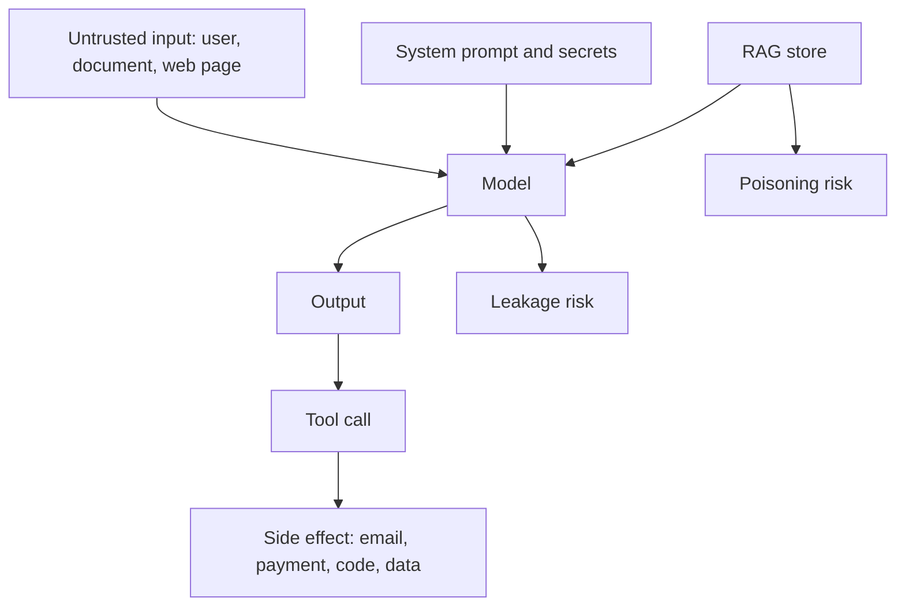

## Two questions, one part

**1. Securing AI systems.** What can go wrong in an application built on a model: prompt
injection, data leakage, tool misuse, model supply chain.

**2. AI as a security tool.** What models do for attackers (recon, phishing text, code review)
and for defenders (triage, summarisation, detection assistance).

They are different problems with different controls, and this part keeps them separate.

## What changed in the standards

| Standard | Version used here | Why it matters |
| --- | --- | --- |
| OWASP LLM Top 10 | 2026 | The application-layer risk list |
| OWASP Agentic Top 10 | 2026 | New: risks of systems that take actions |
| MITRE ATLAS | v2026.10 | Adversary tactics against ML systems |
| NIST AI RMF | 1.0 (2023) + GenAI Profile | Governance and risk framing |

The agentic list is the important addition. A chatbot that answers questions has one risk
profile; an agent with access to email, code, and payment APIs has another entirely.

## The core insight

A model is not a security boundary. It is a **probabilistic component** that processes untrusted
text and produces text which your application then acts on.

```text
untrusted input -> model -> output treated as instruction or data -> side effect
```

Every AI vulnerability in this part is some version of that chain. The controls are at the ends,
not in the model: validate input, constrain tools, and never let model output become authority
without a deterministic check.

## Pages in this part

- [LLM Top 10:2026](/ai-security/llm-top-10-2026/) — the application risks, category by category
- [Agentic Top 10:2026](/ai-security/agentic-top-10-2026/) — what changes when the model acts
- [Prompt injection](/ai-security/prompt-injection/) — direct, indirect, and why it is unsolved
- [RAG security](/ai-security/rag-security/) — retrieval, access control, and corpus poisoning
- [Model supply chain](/ai-security/model-supply-chain/) — weights, datasets, and packages
- [AI in offence](/ai-security/ai-in-offence/) — automation of recon, phishing and code review
- [AI in defence](/ai-security/ai-in-defence/) — triage, detection, and the limits
- [MITRE ATLAS](/ai-security/mitre-atlas/) — the adversarial ML knowledge base

## The honest summary

- **Prompt injection is not solved.** There is no input filter that fixes it. Design so that
  injected instructions cannot cause harm.
- **Agents multiply risk.** Every tool you give an agent is a capability an attacker may inherit.
- **AI-generated findings need verification.** Both in offence and defence.
- **Regulation is arriving.** The EU AI Act imposes obligations by risk class, alongside GDPR.

## A threat model in one page



Ask at each arrow: what is the worst thing that can cross it, and what deterministic check
exists? If the answer is "the model decides", the boundary is not a boundary.
