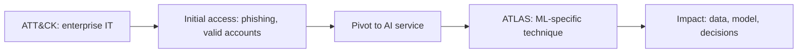

## What ATLAS is

MITRE ATLAS (Adversarial Threat Landscape for Artificial-Intelligence Systems) is a knowledge
base of tactics, techniques and case studies describing attacks on ML systems. Current content
is v2026.10.

It is to AI systems what ATT&CK is to enterprise IT: a vocabulary for **observed behaviour**, with
procedures and mitigations attached.

## How it is organised

| Element | Meaning |
| --- | --- |
| Tactics | The adversary's goal (recon, initial access, exfiltration, impact) |
| Techniques | How the goal is achieved (e.g. poisoning, model extraction) |
| Case studies | Real incidents mapped to techniques |
| Mitigations | Controls that address a technique |

ATLAS tactics overlap with ATT&CK, which is deliberate: an AI system sits inside an enterprise,
and attackers use both.

## Techniques worth knowing

**Reconnaissance.** Discovering model endpoints, versions, and capabilities. Often public
documentation, sometimes error messages.

**Model extraction / stealing.** Querying a model to approximate it. Relevant when the model is
the product; API rate limits and output watermarking are partial mitigations.

**Data poisoning.** Manipulating training or retrieval data. The control is provenance and
ingestion review, not model architecture.

**Backdoor.** A model that behaves normally except on a trigger. Requires behavioural testing and
supply-chain trust.

**Prompt injection.** ATLAS maps it as an initial-access and impact technique. The controls are
architectural, as described in [prompt injection](/ai-security/prompt-injection/).

**Adversarial examples.** Inputs crafted to cause misclassification. Matters for security
classifiers, content filters, and biometric systems.

**Exfiltration via model output.** Sensitive data in prompts, retrieval, or training data leaking
through responses.

## ATLAS and ATT&CK together

A realistic chain: phish an engineer (ATT&CK), steal a token for the model registry (ATT&CK),
replace a model artefact (ATLAS), and poison downstream decisions. Each half needs its own
vocabulary, which is why both exist.

## Using ATLAS in practice

**Threat modelling.** Walk the tactics against your system: what would recon look like, how would
poisoning reach the pipeline, what is the exfiltration path?

**Detection mapping.** For each technique, name the telemetry that would show it. Model registry
audit logs, training job metadata, retrieval access logs, and egress from inference hosts.

**Red teaming.** Use case studies as scenario templates. They are concrete and already mapped to
techniques.

**Procurement.** Ask vendors which ATLAS techniques they test for. Most will not have an answer;
that is informative.

## Limitations

- AI security is young; the case-study base is smaller than ATT&CK's.
- Many techniques are demonstrated in research settings, not observed at scale in the wild.
- Mapping between ATLAS, OWASP LLM Top 10, and NIST AI RMF is imperfect. Do not pretend it is
  one-to-one.

Cite the version (v2026.10) when you use it, because the content changes.

## Exercise

Take the LLM application you built for the prompt-injection exercise. Map it:

1. Which ATLAS tactics apply?
2. Which techniques could reach your retrieval store?
3. What telemetry exists for each?
4. Which techniques have no detection at all?

The fourth answer is your next control.
