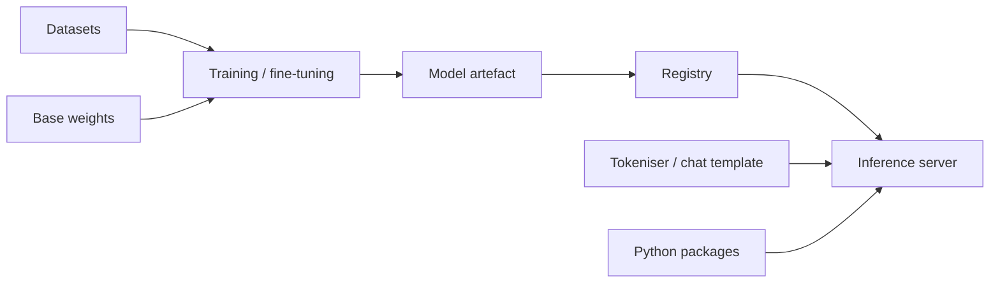

## The components

An AI system is not one artefact. It is a stack:



Each node is a supply-chain risk, and most teams only review the top one.

## The attack patterns

**Malicious model file.** Pickle-based weight files can execute code on load. Formats such as
`safetensors` avoid this; `torch.load` on an untrusted `.pt` does not.

```python
# VULNERABLE: arbitrary code execution on load
model = torch.load("downloaded.pt")

# SAFER: a weights-only format
from safetensors.torch import load_file
weights = load_file("model.safetensors")
```

**Backdoored model behaviour.** A fine-tuned model that behaves normally except on a trigger
phrase. Detection is hard; provenance and behavioural testing help.

**Dataset poisoning.** Injected samples that create a backdoor or bias. Relevant for fine-tuning
and for RAG ingestion.

**Malicious package.** A `transformers`-adjacent package that exfiltrates environment variables on
import.

**Compromised registry account.** A popular model replaced by a modified version.

**Inference server vulnerabilities.** A serving framework with an RCE, exposed to the network.

## Controls that scale

| Control | Applies to | Effort |
| --- | --- | --- |
| Pin versions and hashes | Models, datasets, packages | Low |
| Prefer safe serialisation formats | Weights | Low |
| Verify signatures / provenance | Artefacts | Medium |
| Scan dependencies | Packages | Low |
| Allow-list model sources | Registry | Low |
| Isolate model loading | Inference host | Medium |
| Behavioural test suite | Fine-tuned models | Medium |
| Log and monitor egress | Runtime | Low |

The first six are ordinary software supply-chain hygiene. AI does not change the principles; it
adds artefacts that teams are not used to treating as code.

## Datasets

- Record provenance: where each dataset came from, who approved it, when.
- Hash the dataset used for a training run; store the hash with the model.
- Review ingestion pipelines for untrusted sources (web scrapes, user uploads, third-party corpora).
- For RAG, treat every document as untrusted input, with access control at retrieval time.

## Inference hosting

- Do not expose the model server directly to the internet without authentication.
- Run it with a non-root user and no unnecessary capabilities.
- Restrict egress: a model server rarely needs to call arbitrary hosts.
- Keep prompts and completions out of logs by default, or redact them.

## Detection

- A model file whose hash differs from the pinned value.
- A package installing from an unexpected registry.
- Outbound connections from the training or inference environment.
- Unusual tokens or trigger-like phrases appearing in inputs.
- A model update outside the change window.

## Exercise

1. Download a small open model and record its hash.
2. Load it once with a safe format and once with a format that allows code execution (in an
   isolated container, with no network).
3. Compare what each loader can do.
4. Add hash pinning and an egress-deny rule to the container.

Step 3 is the lesson: the loader is part of the attack surface, and it is chosen by whoever wrote
the deployment script.
