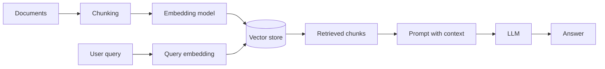

## What RAG adds

Retrieval-augmented generation lets a model answer from documents it was not trained on. The
pipeline is:



Every new component is a new trust boundary: ingestion, chunking, embedding, the vector store,
retrieval, and the prompt assembly.

## The four failure modes

**1. Cross-tenant retrieval.** The vector store returns chunks belonging to another user because
the filter was applied after retrieval, or not at all.

**2. Poisoned corpus.** An attacker who can write a document injects instructions or false facts
that surface later, for other users.

**3. Prompt injection through retrieval.** Retrieved text is treated as context, but the model may
follow instructions inside it. This is [indirect prompt injection](/ai-security/prompt-injection/).

**4. Embedding leakage.** Embeddings can reveal information about the source text; access to the
vector store is access to a representation of the corpus.

## Access control is the hard part

The retrieval query must be constrained by the **caller's** permissions, not by the model's
judgement.

```python
# VULNERABLE: tenant filter applied after retrieval
chunks = vector_store.search(query, top_k=20)
allowed = [c for c in chunks if c.tenant_id == user.tenant_id]
# the model may already have seen the other tenant's chunks in a rerank step

# FIXED: the filter is part of the query
chunks = vector_store.search(
    query,
    top_k=8,
    filter={"tenant_id": user.tenant_id, "acl": {"$in": user.groups}},
)
```

Two rules:

1. **Filter at query time**, in the store, using server-side identity.
2. **Re-check at use time**: each chunk carries its source and ACL; the prompt builder drops
   anything the caller cannot read.

The second check catches index bugs and stale ACLs.

## Ingestion controls

- Provenance per document: who uploaded it, from where, when.
- Virus and content scanning before indexing.
- A review step for documents from untrusted sources.
- Chunk-level metadata (ACL, tenant, source, hash).
- Deletion that propagates to the vector store, not just the source system.

## Poisoning

An attacker with write access to a knowledge base can:

- Add instructions that change agent behaviour.
- Insert false facts that the model repeats confidently.
- Add documents that trigger retrieval for high-value queries.

Controls: write authorisation, review for official corpora, anomaly detection on new content,
and retrieval provenance shown to the user ("answer based on these three documents").

## Prompt assembly

- Delimit retrieved content clearly and label it as untrusted data.
- Never put secrets or authorisation logic in the system prompt.
- Truncate and deduplicate to limit injection surface.
- Log which chunks were used, for audit and incident response.

## Detection

- Retrieval returning documents outside the caller's tenant (should be impossible; alert if it
  happens).
- A new document containing instruction-like phrases (`ignore previous`, `system:`, tool names).
- A spike in document uploads from one account.
- Answers citing sources the user cannot access.
- Query patterns that probe for other tenants' content.

## Exercise (local)

Build a two-tenant RAG app with a shared vector store. Then:

1. Ask a question as tenant A that only tenant B's documents answer.
2. Confirm the vulnerable version leaks the answer.
3. Add a server-side filter in the query and at prompt assembly.
4. Poison one document with an instruction and observe what the fix does and does not stop.
