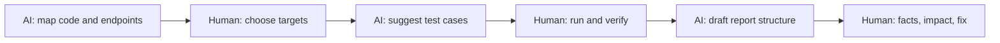

## What works today

LLMs are useful **around** the finding, not usually **at** it.

| Task | Value | Why |
| --- | --- | --- |
| Summarising disclosed reports | High | Pattern extraction at scale |
| Explaining unfamiliar code | High | Faster comprehension |
| Drafting the report | Medium | Structure, not facts |
| Generating payload variants | Medium | Human must verify each |
| Triaging scanner output | Medium | Classification, not confirmation |
| Finding auth bugs in a large codebase | Low | Needs whole-program reasoning |
| Autonomous exploitation | Low today | Reliability and verification gaps |

The pattern: models accelerate **reading, writing and classifying**. They do not reliably decide
what is true.

## The verification rule

Any AI-produced claim is a hypothesis until you reproduce it. That applies to:

- A suggested payload.
- A claimed vulnerability.
- A generated proof-of-concept.
- A summary of a report you did not read.

The failure mode is confident nonsense: a plausible CVE reference, a payload that cannot work,
an impact statement with invented numbers. Treat model output like a tip from a stranger.

## Where AI changes the economics

Two real shifts:

**1. Code review at scale.** Models can scan large codebases for patterns (missing authorisation
checks, unsafe deserialisation) faster than a human reads them. The output is a candidate list;
a human confirms.

**2. Report volume.** Since 2025, programmes report a surge of low-quality, AI-generated
submissions. Google paused some OSS VRP submissions in October 2026 in response. The consequence
for researchers: **signal matters more than volume**. A precise report with a real reproduction
outperforms ten plausible ones.

```text
AI-generated report, unverified:
  "This endpoint appears vulnerable to IDOR. An attacker could access other users' data."
Real report:
  "GET /api/v2/invoices/1042 with user A's session returns user B's invoice.
   Two accounts, 200 OK, body included name/address. Timestamp attached."
```

Only one of those gets paid.

## Practical workflow



Use the model to compress reading time, not to replace judgement.

## Prompt patterns that help

```text
# Code review, bounded
"You are reviewing an Express route. List places where the caller's identity is
not checked against the object being returned. Quote the exact lines and say
what a request would need to look like to exploit each. Do not claim a bug
without a line reference."

# Report drafting, bounded
"Rewrite these verified facts as a bug bounty report with Summary, Steps,
Impact, Remediation. Do not add facts, numbers, or claims not present below."
```

The second prompt is the important one: **do not add facts**.

## Risks to the researcher

- **Hallucinated scope.** A model may invent a programme rule. Read the actual scope.
- **Leaked reports.** Pasting a private report into a third-party model may breach the
  programme's confidentiality terms. Check the policy.
- **Unverified PoCs** executed against production. Sandbox first.
- **Attribution of AI work.** Some programmes require disclosure of AI assistance; follow their
  rules.

## What this means for the field

AI lowers the cost of the *first draft* of a finding and raises the cost of *triage*. The
researchers who benefit are those who use it to go deeper on verification, not to produce more
reports.

The [AI security part](/ai-security/) covers the other direction: attacking AI systems
themselves, which is now a bounty category in its own right.

## Exercise

Take a disclosed report and a lab target. Use a model to generate five hypotheses about the lab,
then verify each manually and record which were real. The ratio is your calibration for how much
to trust the tool.
