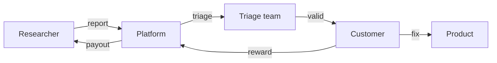

## The three arrangements

**1. Bug bounty programme.** Money for valid findings, with a published scope and reward table.
Usually run on a platform, sometimes self-hosted.

**2. Vulnerability Disclosure Programme (VDP).** Same intake, no money. Common for
government and open source. Still valuable: a legal channel beats a lawsuit.

**3. Paid penetration test.** A contract with a defined scope and a report. Not a bounty: the
tester is hired, not competing.

Confusing these causes trouble. A VDP does not imply a reward; a bounty does not imply a
contractor relationship; a pentest does not imply public disclosure rights.

## Who is involved



Some programmes triage in-house, some outsource, some let the platform triage. Response time and
quality depend on this choice more than on the reward table.

## Reputation and payments

- **Reputation** (platform score) affects invitation-only programmes.
- **Payouts** vary from thanks to six figures for critical findings in high-value targets.
- **Bonuses** appear for fast triage, exceptional reports, or retest confirmation.
- **Swag** is common at the low end and is not compensation in any legal sense.

Tax treatment of bounty income differs by country. In the EU it is generally taxable income; keep
records.

## Scopes, and how they are written

A scope is a legal boundary and a technical one:

```text
In scope:      *.example.com, the iOS app, api.example.com/v2
Out of scope:  status.example.com, third-party SaaS, anything hosted by CDN provider
Rules:         no automated scanners above 5 req/s, no DoS, no social engineering,
               test accounts only, report within 24h of finding critical
```

Wildcards usually exclude payment flows, partner portals, and anything the organisation does not
own. When in doubt, ask through the programme's channel. Asking is free; assuming is not.

## Disclosure norms

- **Coordinated disclosure**: report privately, agree a timeline, publish after a fix.
- **90 days** is the common default; some programmes require longer, some shorter.
- **Full disclosure** without coordination is legal in some places and damaging everywhere.
- **Bug bounty reports are confidential** unless the programme publishes them.

The [responsible disclosure page](/law/responsible-disclosure/) covers the legal side.

## Open source and AI targets

- **huntr** and similar platforms cover open-source projects and AI/ML components.
- Major AI vendors run their own programmes (OpenAI via Bugcrowd, Anthropic via HackerOne,
  Google's AI Vulnerability Reward Program).
- Model and agent vulnerabilities often fall under separate policies, with narrower scope than
  classic web assets.

Read the policy before testing an AI feature. Prompt injection against a production chatbot may
be explicitly out of scope.

## What platforms do not tell you

- How many researchers are already on the target.
- How quickly the customer actually fixes things.
- Whether the reward table will be honoured for a novel bug class.

You learn these from disclosed reports, community discussion, and experience. That is why
choosing a programme is a research task, not a lottery.
