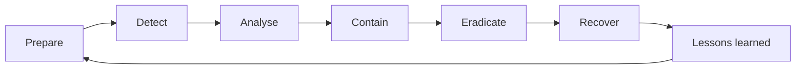

## The lifecycle



NIST SP 800-61 Rev. 3 (2025) keeps this shape but emphasises **preparation and coordination** over
a rigid sequence. Real incidents loop: containment reveals new scope, recovery triggers another
detection.

## The first hour

1. **Confirm** — is this real? One corroborating source, not a hunch.
2. **Declare** — name an incident commander and a channel. Ambiguity costs hours.
3. **Preserve** — snapshot volatile evidence before changes.
4. **Contain** — isolate the smallest thing that stops spread. Do not wipe.
5. **Assess** — what data, which systems, which identities.
6. **Notify** — internal stakeholders and, if applicable, the regulator.

Write the time of each step. The timeline is the report.

## Containment trade-offs

| Action | Stops | Costs |
| --- | --- | --- |
| Isolate host | Lateral movement | Business process stops |
| Disable account | Credential abuse | User cannot work |
| Block domain/IP | C2 | May miss alternate channels |
| Rotate all credentials | Reuse | Wide disruption, must be coordinated |
| Restore from backup | Encryption | May restore the vulnerability too |

Choose the smallest effective action, and record why. "We shut everything down" is sometimes
right, but it should be a decision, not a reflex.

## Evidence preservation

Order of volatility, highest first:

```text
CPU registers / cache -> memory -> network connections -> running processes
-> disk -> logs on remote systems -> backups -> archival media
```

Practical minimum:

- Memory image of key hosts if you have tooling.
- Disk image or snapshot before reimaging.
- Full packet capture if available.
- Export logs before retention rolls.
- Chain of custody: who collected what, when, with which tool, and a hash.

If you reimage without evidence, you cannot answer "how did they get in", and you will be
breached again.

## Communication

- **Internal**: executives want impact and decisions, not technique.
- **Technical**: analysts need facts, timestamps and scope.
- **Regulator**: legal deadlines, defined content.
- **Customers**: honest, specific, no speculation.
- **Press**: one voice, prepared statements.

Under GDPR, a personal data breach must be notified to the supervisory authority within **72
hours** of awareness, unless it is unlikely to result in a risk. That clock starts early and does
not pause for investigation.

## Ransomware specifics

1. Do not pay without legal and executive decision; payment may violate sanctions.
2. Preserve evidence; the decryptor may not work.
3. Check backup integrity before restoring.
4. Expect exfiltration even if encryption failed.
5. Notify per NIS2/sector rules if in scope.

## Lessons learned

Within two weeks, answer:

- What was the initial access vector?
- How long until detection, and what detected it?
- What slowed containment?
- Which controls failed, and which worked?
- What will be different in 30 days?

Assign owners and dates. An after-action report with no changes is a ritual.

## Exercise

Run a tabletop with four people:

1. A phishing email leads to a workstation compromise at 09:00.
2. At 11:00, the attacker has domain admin.
3. At 14:00, file shares are encrypted.

For each timestamp, decide: who is called, what is isolated, what is preserved, who notifies whom.
Then compare your decisions to your written plan. The gaps are your next project.
