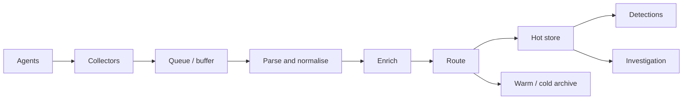

## The pipeline in full



Each stage has a failure mode that produces the same symptom: **silent gaps**. The pipeline must
be monitored like any other production system.

## Collection

| Source type | Mechanism | Watch for |
| --- | --- | --- |
| Linux hosts | `journald` / syslog forwarder | Rotation, disk-full, service restart |
| Windows | Event forwarding / agent | Subscription gaps, channel disabled |
| Cloud | Audit log export to storage | Region coverage, export failures |
| Network | Flow, DNS, proxy | Sampling rate, retention |
| Applications | Structured JSON to stdout | Schema drift, PII in fields |
| Identity | Directory audit APIs | API throttling, missing event types |

Agents should buffer locally, so a network outage does not lose events. But a buffer is not a
queue: size it, monitor it, and alert when it fills.

## Parsing and normalisation

The goal is that every event has the same field names for the same concepts:

```text
@timestamp, event.action, event.outcome, user.name, source.ip,
destination.ip, process.name, process.command_line, host.name,
cloud.provider, cloud.account.id, rule.name
```

Use an existing schema (ECS or OCSF) rather than inventing one. Map each source once, test with
sample events, and version the mapping.

Common failures:

- Timestamps in local time, or without a timezone.
- Nested JSON flattened inconsistently.
- Duplicate events from two collectors.
- Multiline stack traces split into separate events.

## Enrichment

Add context at ingest, so queries stay simple:

- Asset criticality and owner (from the CMDB).
- Identity type (human, service, admin).
- GeoIP and ASN.
- Threat intel matches, with a timestamp and confidence.
- Environment (prod, staging, lab).

Do not enrich with data you cannot keep fresh. A stale asset owner sends the wrong alert to the
wrong person.

## Buffering and backpressure

- A durable queue between collectors and the index (Kafka, Redis, or a disk buffer).
- Bounded memory; drop low-value events first, never auth or process events.
- Alert when the queue depth grows for more than a few minutes.

Backpressure is normal during an incident, exactly when logs matter most.

## Routing and retention

```text
Auth + endpoint process  -> hot 30 days, warm 1 year, archive 7 years
Debug / health checks    -> drop at collector
Proxy full URLs          -> hot 14 days, then aggregate
Cloud audit              -> hot 90 days, archive per regulator
```

Retention is driven by legal and investigative needs, not by storage cost alone. Check NIS2,
sector rules and GDPR before shortening it.

## Integrity

- TLS in transit, encryption at rest.
- Write-once or object-lock for critical indexes.
- Restrict deletion rights; log who deleted what.
- Hash or sign archive bundles.
- Time-source monitoring: a skewed clock invalidates a timeline.

## Monitoring the pipeline itself

| Signal | Meaning |
| --- | --- |
| Events per second by source | Drop = broken collector or disabled logging |
| Last event time per source | Silence = gap |
| Parse failure rate | Schema drift |
| Queue depth | Backpressure or index slowdown |
| Index rejection rate | Mapping conflict, field explosion |
| Agent version distribution | Old agents miss fields |

The "last event time per source" alert catches more real incidents than most detection rules,
because attackers disable logging.

## Exercise

1. Collect syslog and JSON application logs into one store.
2. Normalise both to the same field names.
3. Add asset criticality enrichment from a small CSV.
4. Stop one source and confirm you alert on silence.
5. Delete an index and confirm the deletion is itself logged and alertable.
