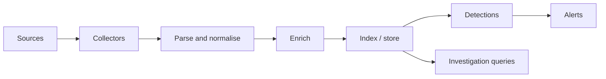

## The pipeline



Most failures happen at **parse and normalise**: fields are missing, timestamps disagree, and the
same event has different names from different sources.

## What to collect first

| Priority | Source | Why |
| --- | --- | --- |
| 1 | Identity provider / domain controller | Most initial access and lateral movement |
| 2 | Endpoint process creation | Execution and defence evasion |
| 3 | Cloud control plane | Persistence, privilege changes |
| 4 | DNS and proxy | C2 and exfiltration |
| 5 | Email gateway | Phishing |
| 6 | EDR telemetry | Rich endpoint detail |
| 7 | Application auth logs | Business app abuse |

Collect in that order. A SIEM with everything and no identity logs is a data lake with a search
box.

## Schema discipline

Pick a schema and enforce it. The common choices:

- **ECS** (Elastic Common Schema) for Elastic.
- **OCSF** for vendor-neutral security events.
- **OpenTelemetry** semantic conventions for logs and traces.

The point is that `user.name` is always `user.name`, regardless of source. Without that, every
query becomes source-specific and detections do not compose.

## Time

- Normalise to UTC on ingest.
- Record the original timestamp as a field.
- Alert on clock drift; a host an hour behind breaks timelines.
- Store ingest time as well as event time; they differ during outages.

## Retention

```text
Hot    (searchable, 7–30 days)   : triage and investigation
Warm   (searchable, 90–365 days) : incident review, compliance
Cold   (archived, 1–7 years)     : legal hold, forensics
```

Retention is a legal question as much as a storage one. NIS2, sector rules and GDPR each impose
constraints. Check yours; do not assume a default.

## Log integrity

- Ship logs off the host immediately; local logs are attacker-editable.
- Use write-once storage or append-only buckets for critical logs.
- Restrict who can delete or modify indexes.
- Alert when a log source stops sending (the "silent failure" problem).

That last control catches more real incidents than many detection rules: an attacker who disables
logging is visible as a gap.

## Queries that find things

```text
# Authentication from a new country for a privileged account
# Process creation by a service account that normally runs none
# DNS queries to domains registered in the last 30 days
# Cloud role assumption by a principal that never did it before
# A log source silent for longer than its expected interval
```

Start with baselines. "Never before" is a better signal than "matches a known bad string".

## Cost control

SIEM costs scale with ingest. Reduce before you buy more:

- Drop debug and health-check logs at the collector.
- Aggregate repetitive events.
- Sample high-volume, low-value sources (with care).
- Keep full fidelity for identity and endpoint process events.

## Exercise

1. In a lab, collect auth and process logs from one Linux host.
2. Normalise them to a fixed schema.
3. Write a query for "successful login after five failures from one IP".
4. Break the collector and confirm you have an alert for the silence.

Step 4 is the difference between logging and monitoring.
