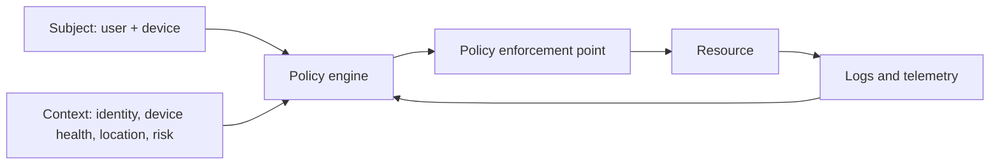

## The definition

NIST SP 800-207: zero trust is a set of principles, not a product.

1. **No implicit trust** from network location.
2. **Every request is authenticated and authorised**, using the best available signals.
3. **Least privilege**, just-in-time where possible.
4. **Assume breach**: segment, monitor, and limit blast radius.
5. **Policy is dynamic**, based on identity, device, and context.

The phrase "the network is hostile" is the starting assumption; it does not mean "trust nothing",
it means "verify everything explicitly".

## What it is not

- Not a VPN replacement, though it may replace one.
- Not a single product, though vendors sell "zero trust platforms".
- Not "no firewall"; it is fine-grained policy, which still needs enforcement points.
- Not a project with an end date; it is a maturity direction.

## The architecture



The **policy engine** decides. The **enforcement point** applies the decision. Telemetry feeds
back, so the decision can change.

## A practical migration

Do not start with a rewrite. Start with the highest-risk access paths:

| Step | Change | Effort |
| --- | --- | --- |
| 1 | Strong identity: SSO, MFA, passkeys | Low |
| 2 | Device inventory and health signals | Medium |
| 3 | Application-level access instead of network-level | Medium |
| 4 | Least privilege and JIT for admin | High |
| 5 | Segmentation with default-deny | High |
| 6 | Continuous verification and risk scoring | High |

Step 1 alone removes most credential-based incidents. That is why identity is the first
enforcement point.

## Segmentation, concretely

- Default-deny between workloads; allow explicit flows.
- Separate admin planes from data planes.
- No flat "internal" network with trust.
- Egress control, because exfiltration needs a path out.

Kubernetes network policies, cloud security groups, and service mesh policies are all
enforcement points for the same principle.

## Identity is the control plane

- Every workload has its own identity, short-lived credentials.
- Human access is per-application, not per-network.
- Privileged access is brokered, recorded, and time-bound.
- Device posture is part of the decision, not an afterthought.

## Measuring progress

```text
Percentage of apps reachable without network-level access
Percentage of admin actions with JIT and recording
Percentage of workloads with a distinct identity
Lateral movement paths remaining (from a graph analysis)
```

The last one is the honest test: run an attack-path analysis and count the paths from a
compromised laptop to tier-0.

## The failure mode

Zero trust projects fail when they become a product rollout: a new proxy, a new agent, no change
in authorisation model. The test is whether a compromised credential from an unknown device can
reach a sensitive resource. If yes, the architecture has not changed.

## Exercise

1. Draw your current access paths from a user laptop to your most sensitive data store.
2. Mark every place where "being inside the network" grants access.
3. Choose one path and replace network trust with identity-based authorisation.
4. Re-run the attack-path analysis and count the remaining paths.

Step 4 is the measure of whether the project is real.
