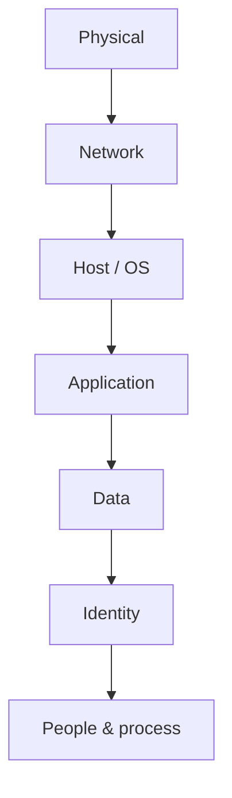

## The three properties

Security is not a product. It is the preservation of properties you decided matter.

| Property | Meaning | Failure example |
| --- | --- | --- |
| **Confidentiality** | Data is read only by those entitled to it | A misconfigured S3 bucket exposes customer records |
| **Integrity** | Data and code are what they should be | An attacker modifies a bank transfer amount in transit |
| **Availability** | Systems respond when needed | Ransomware encrypts a hospital's records |

Add two more that modern practice treats as first-class:

- **Authenticity** — a message really came from who it claims.
- **Non-repudiation** — the sender cannot credibly deny sending it.

Every control in this wiki exists to preserve one or more of these. When a control does not
map to one, ask why it is there.

## Assets, threats, vulnerabilities, risk

Four words that get mixed up constantly:

- **Asset** — something with value: data, a service, a reputation, a process.
- **Threat** — who or what could act against the asset. A person, a group, an accident, a flood.
- **Vulnerability** — a weakness that a threat could exploit.
- **Risk** — the combination: how likely, how bad.

```text
Risk ≈ Likelihood × Impact
```

That formula is deliberately crude. It is still the right first question: what could happen,
and how much would it cost? The [risk page](/foundations/cia-triad-and-risk/) expands it.

## Attack surface and trust boundaries

**Attack surface** is everything an attacker can reach: open ports, input fields, APIs, staff,
suppliers. **Trust boundaries** are the lines where data or control passes from something less
trusted to something more trusted — browser to server, service to database, user to admin.

Almost every vulnerability in this wiki is a broken assumption at a trust boundary. Input
validation, authorisation, sandboxing and cryptography are all attempts to make a boundary
hold.

## The layers

Security is usually described in layers, because no single control is sufficient:



Defence in depth means an attacker must defeat several layers. It does not mean stacking
redundant products; five anti-virus agents are one layer.

## The defensive lifecycle

NIST CSF 2.0 organises defensive work into six functions, and it is the cleanest map of the
field:

| Function | Question it answers |
| --- | --- |
| **Govern** | Who owns this risk, and under what policy? |
| **Identify** | What do we have, and what matters? |
| **Protect** | What controls reduce the chance of harm? |
| **Detect** | How would we know something is happening? |
| **Respond** | What do we do when it happens? |
| **Recover** | How do we get back to normal? |

If a security programme cannot answer all six, it has a gap, regardless of how many tools it
bought.

## What the rest of the wiki builds on

- [CIA triad and risk](/foundations/cia-triad-and-risk/) — the model in depth
- [Threat modelling](/foundations/threat-modelling/) — how to reason about a specific system
- [Cryptography basics](/foundations/cryptography-basics/) — what crypto does and does not fix
- [Networking and protocols](/foundations/networking-and-protocols/) — where traffic actually goes
- [Operating system internals](/foundations/operating-system-internals/) — processes, memory, permissions
- [Identity and access](/foundations/identity-and-access/) — authentication, authorisation, sessions

## A beginner's mental model

> A system is a set of promises. Security is checking which promises are enforced by
> mechanism, which by convention, and which by hope.

Most breaches are the third category. The [history part](/history/) shows this repeating for
fifty years.
