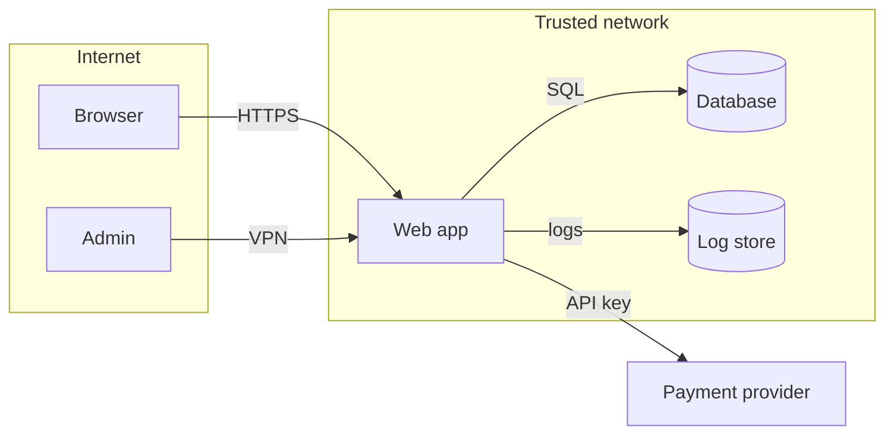

## What a threat model is

A threat model is four answers on one page:

1. **What are we building?** A diagram with trust boundaries.
2. **What can go wrong?** A list of threats against that diagram.
3. **What are we going to do about it?** A control per credible threat.
4. **Did we do a good job?** A review that compares the model to the system.

It is not a document you write once. It is a conversation that produces a diagram and a list.

## Step 1 — draw the system

Boxes are components. Arrows are data flows. Dashed lines are **trust boundaries**: places
where data crosses from less trusted to more trusted.



The diagram is worth more than the prose. Most missed threats are a boundary nobody drew.

## Step 2 — ask STRIDE questions

STRIDE is a mnemonic for six ways a boundary can fail:

| Letter | Threat | Question at each boundary |
| --- | --- | --- |
| **S** | Spoofing | Can someone claim to be another identity? |
| **T** | Tampering | Can data be changed in transit or at rest? |
| **R** | Repudiation | Can an actor deny doing this? |
| **I** | Information disclosure | Can data leak to someone not entitled? |
| **D** | Denial of service | Can one actor exhaust a shared resource? |
| **E** | Elevation of privilege | Can a lower-privileged actor gain more rights? |

Apply STRIDE per arrow crossing a boundary, not once per system. The output is a table:

| Boundary | Threat | Scenario | Control |
| --- | --- | --- | --- |
| Browser → web app | Spoofing | Stolen session cookie replayed | Bind session to device, rotate on login |
| Web app → database | Tampering | SQL injection changes rows | Parameterised queries, least-privilege DB user |
| Admin → web app | Elevation | Admin route trusts a client-side flag | Server-side role check on every route |

## Step 3 — rank, don't catalogue

A model that lists 200 threats is useless. Keep the ones where **both** are true:

- The attacker has a plausible path to the boundary.
- The impact is one you would actually have to report.

Everything else goes in an appendix labelled "considered and rejected", so the next reviewer
knows it was not missed.

## Step 4 — verify against the build

The failure mode of threat modelling is a beautiful document that the code ignores. Compare
the model to the implementation:

- Does every drawn boundary exist in the deployment, or is the "trusted network" actually flat?
- Does every control in the table have a test that fails if removed?
- Has the architecture changed since the diagram? A new queue, a new third-party API, a new admin path?

A useful habit: re-read the threat model at the same time as the last commit that changed
authentication or authorisation.

## A worked example: password reset

```text
System: reset by email link.
Boundary 1: user -> web (untrusted input: email address)
Boundary 2: web -> mail provider (untrusted: link content)
Boundary 3: mail client -> web (untrusted: token in URL)
```

Threats:

- **Enumeration** — does the response reveal whether an account exists?
- **Token predictability** — is the token random, single-use, time-bound, and bound to the user?
- **Host header injection** — does the reset link use an attacker-controlled `Host` header?
- **Referrer leakage** — does the token travel in a URL that leaks to third-party scripts?
- **Race** — can the same token be used twice concurrently?

Five threats, five controls, all testable. That is a good threat model: small, specific, and
mapped to tests.

## When to skip it

You never skip it, but you scale it. A one-page feature gets a five-minute conversation and a
sketch; a payment flow gets a formal model reviewed by someone outside the team. The
[pentesting methodology](/pentesting/methodology/) starts from the same artefact, because a
tester who does not understand the intended trust boundaries cannot tell a bug from a design
decision.
