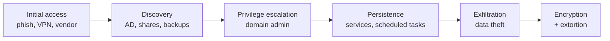

## Supply chain: attacking the people your target trusts

A supply chain attack compromises something the target already trusts: a build pipeline, a
dependency, an update mechanism, a managed service provider. The target's own defences are
irrelevant because the payload arrives signed and expected.

**SolarWinds (2020)** is the canonical case. Attackers modified the Orion build process so
that a legitimate update carried a backdoor. Thousands of customers installed it. Detection
was hard because the binary was signed, the traffic was expected, and the implant was
dormant for a long time.

Three structural lessons:

1. **Build systems are production.** If an attacker controls compilation, code review is theatre.
2. **Trust is transitive and rarely audited.** "Signed by the vendor" means "the vendor's key
   signed it", not "the vendor is trustworthy".
3. **Detection must include anomaly baselines** for legitimate management traffic, not just
   signatures of known malware.

Modern mitigations are process controls as much as technical ones: reproducible builds,
provenance attestation (SLSA, sigstore), dependency pinning with hash verification,
least-privilege CI tokens, and egress filtering for build agents. NIST SP 800-161 treats this
as a lifecycle discipline, not a scanner.

## Ransomware operations, 2020s

A modern ransomware incident usually follows a repeatable chain:

Each stage maps to ATT&CK tactics, and each is a detection opportunity. The stage defenders
most often miss is **discovery and exfiltration**, because it looks like administration.

What shortens these incidents in practice:

- **Identity hardening**: phishing-resistant MFA, no standing domain admin, tiered admin model.
- **Backup immutability**: offline or object-locked copies, tested restore.
- **Egress visibility**: know what normally leaves, then alert on the rest.
- **Fast isolation**: an endpoint that can be cut off in minutes limits encryption scope.

## State-linked operations

Nation-state activity differs from crime in goals, patience and stealth:

| Dimension | Criminal | State-linked |
| --- | --- | --- |
| Goal | Money | Intelligence, disruption, pre-positioning |
| Timeline | Days to weeks | Months to years |
| Detection priority | Avoid noise | Avoid attribution |
| Preferred access | Credentials for sale | Zero-days, supply chain, insider |

The defensive consequence is that "we are not interesting enough" is not a risk assessment.
Pre-positioning means access is valuable before anyone uses it.

## Critical infrastructure

Attacks on industrial control systems follow the same pattern at a different layer: gain IT
access, pivot to the OT network, then manipulate or disable physical processes. Stuxnet
(2010) demonstrated the concept; later incidents against power grids and pipelines showed it
had become operational practice.

Security controls that matter in OT differ from IT: availability outranks confidentiality,
patching is slow by design, and safety systems must never depend on the corporate network.
The [defensive part](/defensive/) covers segmentation; the
[law part](/law/) covers the regulatory duties that now attach to these sectors.

## What changed in the last five years

1. **Extortion without encryption** — steal, threaten, skip the crypto. Cheaper and just as effective.
2. **Exploitation of edge devices** — VPN appliances and firewalls became the preferred entry point.
3. **Living off the land** — using built-in tools (`rundll32`, `certutil`, `powershell`) to avoid malware signatures.
4. **Access brokers as a market** — intrusion becomes outsourced.
5. **Regulatory pressure** — NIS2 and the CRA impose duties that did not exist a decade ago.

## Reading list by era

- Pre-web: RFC 1135, *The Cuckoo's Egg*
- Web-era crime: *Spam Nation*, *Sandworm*
- Supply chain: Microsoft's Solorigate analysis, NIST SP 800-161
- Current: ENISA Threat Landscape, Verizon DBIR, CISA KEV

Every one of those is a primary or near-primary source. Reading them in sequence gives a
better sense of the field than any summary, including this one.
