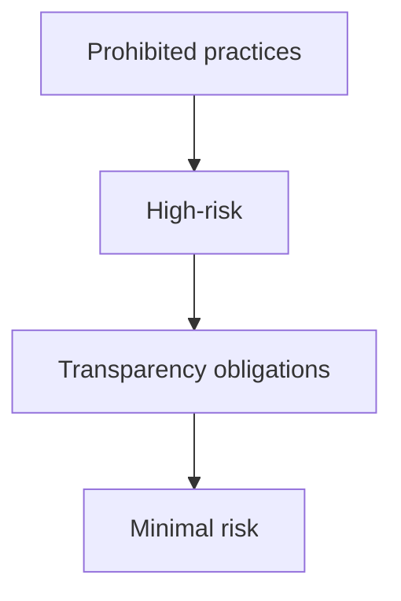

## The shape

The AI Act (Regulation (EU) 2024/1689) entered into force on 1 August 2024. It regulates AI
systems by **risk class**, with obligations phased in:

| Date | What applies |
| --- | --- |
| 2 Feb 2025 | Prohibitions and AI literacy |
| 2 Aug 2025 | General-purpose AI (GPAI) obligations |
| 2 Aug 2026 | High-risk systems, most other obligations |
| 2 Aug 2027 | High-risk systems under product-safety legislation |

By November 2026, the main obligations are in force. Some high-risk categories have longer
transition periods.

## The risk classes

**Prohibited** — social scoring, manipulative techniques exploiting vulnerabilities, untargeted
facial scraping, emotion recognition in workplaces and schools, biometric categorisation of
sensitive attributes, real-time remote biometric identification in public spaces (with narrow
exceptions).

**High-risk** — systems used in critical infrastructure, education, employment, essential
services, law enforcement, migration, justice, and safety components of products. Obligations
include risk management, data governance, technical documentation, logging, human oversight,
accuracy, robustness, and cybersecurity.

**Transparency** — chatbots, deepfakes, emotion recognition: users must be informed.

**Minimal** — most systems; no specific obligations beyond existing law.

## Cybersecurity obligations

For high-risk systems, Art. 15 requires:

- Resistance to unauthorised third-party attempts to alter use or output.
- Protection against model poisoning and adversarial inputs.
- Appropriate accuracy and robustness.
- Resilience to errors and inconsistencies.

That is a security engineering requirement, and it maps closely to
[OWASP LLM Top 10](/ai-security/llm-top-10-2026/) and
[MITRE ATLAS](/ai-security/mitre-atlas/).

## GPAI obligations

Providers of general-purpose models must:

- Provide technical documentation and usage information.
- Publish a summary of training data.
- Respect copyright and opt-out rules.
- For systemic-risk models: model evaluation, adversarial testing, incident reporting,
  cybersecurity protection.

Open-source GPAI models have reduced obligations, with exceptions for systemic risk.

## What a security team should do

1. **Inventory AI systems** — including embedded AI in products and third-party features.
2. **Classify risk** — prohibited, high-risk, transparency, minimal.
3. **Map controls** — for high-risk, the Art. 15 security requirements map to your existing
   threat model, testing, and supply-chain controls.
4. **Document** — technical documentation is an obligation, not a nice-to-have.
5. **Monitor** — post-market monitoring and incident reporting.

## Interaction with GDPR

The AI Act does not replace GDPR. Personal data processing in an AI system still needs a legal
basis, a DPIA where required, and data-subject rights. A high-risk AI system often triggers both
regimes.

## Exercise

Take an AI feature you use (a chatbot, a recommender, a code assistant):

1. Classify its risk under the Act.
2. List the obligations that apply.
3. Map each to a control that exists or is missing.
4. Identify the documentation you would need to produce.

If the classification is "minimal", say why — most people guess wrong in both directions.
