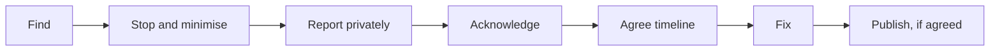

## The process



Each step has a failure mode that turns a researcher into an accused person.

## The researcher's obligations

1. **Stop at proof.** One record, one command output, one screenshot. No lateral movement.
2. **Do not retain data** you do not need. Delete test data.
3. **Report privately**, through the published channel or a security contact.
4. **Set expectations**: what you found, how to reproduce, your disclosure intention.
5. **Give time**. 90 days is the common norm; critical infrastructure may need longer.
6. **Coordinate publication** with the vendor.

## The organisation's obligations

A disclosure programme is a business control, not charity:

- A published security contact (`security.txt`, per RFC 9116).
- Acknowledgment within days, not months.
- A fix timeline, with updates.
- No legal threats for good-faith research.
- Credit, if the researcher wants it.

Organisations that respond badly lose the next report. The vulnerability does not disappear; it
moves to a market.

## Safe harbour

A safe harbour statement says the organisation will not pursue legal action against researchers
who follow the rules. What to check:

| Question | Why |
| --- | --- |
| Who is bound? | A subsidiary may not bind the parent |
| Which assets? | Scope must be explicit |
| Which data? | Third-party data may be excluded |
| What counts as a violation? | Ambiguity favours the organisation |
| Is it a promise or a policy? | A policy can change |

Safe harbour is not a statute. It reduces risk; it does not eliminate it.

## timelines that work

```text
Day 0    report sent
Day 1-3  acknowledgment
Day 7    triage decision and severity
Day 30   fix or a credible plan
Day 90   fix deployed, or disclosure decision
Day 90+  coordinated publication
```

For exploited-in-the-wild vulnerabilities, compress aggressively: notify, mitigate, then fix.

## When the vendor does not respond

Options, in order:

1. Escalate through a national CERT or the platform.
2. Contact a regulator (NIS2 authorities, sector regulators).
3. Publish after a reasonable deadline, with a defensible rationale.

Full disclosure without notice is legal in some places and harmful everywhere. Document your
attempts at contact; that record is your defence and your ethical position.

## Bug bounty versus disclosure

| | Bug bounty | Disclosure |
| --- | --- | --- |
| Trigger | Programme invitation | Any finding |
| Reward | Money or recognition | None guaranteed |
| Obligation | Programme rules | Good-faith norms |
| Timeline | Set by policy | Negotiated |

A VDP without rewards is still a valid channel, and often the only one.

## For organisations: build the programme

Minimum viable:

1. `security.txt` with a contact and a policy URL.
2. An intake mailbox monitored by a human.
3. A triage process with severity criteria.
4. A fix SLA by severity.
5. A public thank-you page, if researchers want credit.
6. Legal review of the safe harbour statement.

The [CRA](/law/eu-cra/) now requires vulnerability handling for products, so this is also a
compliance matter.

## Exercise

Write a disclosure policy for a small company:

1. Scope and exclusions.
2. Contact and response times.
3. Safe harbour wording.
4. Severity and fix SLAs.
5. Publication rules.

Then have someone try to find a loophole in the safe harbour. There always is one; fix it before
a researcher does.
