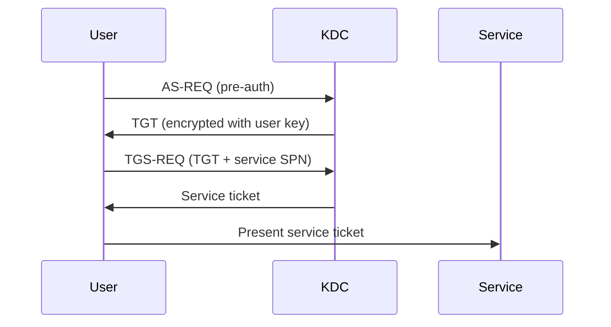

<div class="cw-authorised">
<strong>Authorisation required.</strong> Active Directory attacks affect the whole estate. Only run them in a lab domain or under a scope that explicitly names the domain controller.
</div>

## Why AD is the target

One credential that works everywhere is convenient for users and decisive for attackers. Once
a domain administrator is compromised, every joined machine, file share and service is
reachable.

## Kerberos, the short version



Attack surface follows the tickets: forge them, request too many, crack their encryption, or
relay them.

## The classic techniques

| Technique | Mechanism | Fix |
| --- | --- | --- |
| Kerberoasting | Request service tickets for SPNs, crack offline | Long random service-account passwords, gMSA |
| AS-REP roasting | Pre-auth disabled accounts return crackable material | Require pre-authentication |
| Password spraying | One password, many accounts | Lockout policy, smart lockout, MFA |
| Pass-the-hash | NTLM hash used as a credential | Credential Guard, disable NTLM where possible |
| Pass-the-ticket | Reuse a TGT/service ticket | Short ticket lifetime, detect anomalous logons |
| Golden ticket | Forged TGT using krbtgt hash | Rotate krbtgt twice after compromise |
| Silver ticket | Forged service ticket | Service account hygiene, PAC validation |
| ACL abuse | Write rights that allow takeover (e.g. `GenericAll`) | Audit ACLs, tier-0 isolation |
| AD CS abuse | Misconfigured certificate templates | Remove `ENROLLEE_SUPPLIES_SUBJECT`, require approval |
| Delegation abuse | Unconstrained or constrained delegation | Remove unconstrained; protect privileged accounts |

The pattern: **delegation of authority without verification**. Kerberos trusts tickets; the
domain trusts ACLs; AD CS trusts templates.

## Attack paths, not techniques

BloodHound's contribution was to show that the interesting question is not "which technique"
but "which path from my current user to Domain Admin exists". A typical path:

```text
user -> GenericAll on group -> add self to group -> local admin on server
     -> session with DA -> dump credentials -> domain admin
```

Defenders should run the same analysis. The finding is usually an ACL that was granted for a
project in 2016 and never removed.

## Tiering

The only durable defence is to stop privileged credentials from existing where they are not
needed:

- **Tier 0**: domain controllers, AD CS, identity infrastructure. Only tier-0 admins log in.
- **Tier 1**: servers. Tier-1 admins, no domain admin credentials cached.
- **Tier 2**: workstations. Ordinary users; no admin credentials.

This is a project, not a purchase. Without it, one phished laptop is a domain compromise.

## Detection

- Service ticket requests for many SPNs from one user (Kerberoasting).
- AS-REQ without pre-authentication.
- Failed logons across many accounts with one password (spraying).
- NTLM authentication where Kerberos is expected.
- New members in privileged groups, especially outside change windows.
- Certificate template changes and unusual enrollment.
- Logon type 3 from a workstation to many servers in minutes.

The [defensive part](/defensive/) maps these to ATT&CK and detection rules.

## Exercise (lab domain only)

Build a small domain with two users, one service account, and one server. Then:

1. Kerberoast the service account and measure how long the crack takes.
2. Fix it with a gMSA and a 120-character managed password.
3. Run a BloodHound collection and find the shortest path to Domain Admin.
4. Remove the ACL edge you found and re-run the analysis.

Step 3 usually shows at least one unintended path in a lab built in an afternoon. That is the
lesson: AD accumulates permissions faster than anyone removes them.
