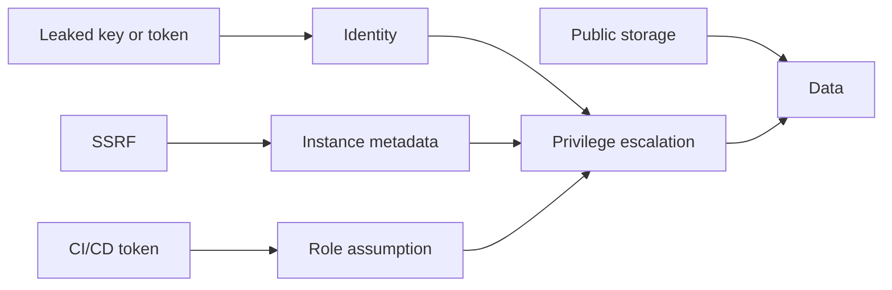

<div class="cw-authorised">
<strong>Authorisation required.</strong> Cloud APIs are production systems. Only test accounts and resources that the scope names, and never another tenant's data.
</div>

## The four paths

Cloud intrusions rarely start with a kernel exploit. They start with a credential and an
over-permissive role.



## 1. Identity

**Long-lived access keys** in repositories, CI variables, and laptop dotfiles. The control is
workload identity federation and short-lived credentials.

**Over-broad roles.** `*:*` on a compute role, or a role that can create new roles. Enumerate:

```bash
# Who am I, and what can I do? (own account only)
# aws sts get-caller-identity
# aws iam list-attached-role-policies --role-name <role>
# aws iam simulate-principal-policy --policy-source-arn <arn> --action-names s3:GetObject
```

**Trust policy mistakes.** A role that trusts `Principal: "*"` with a weak condition, or trusts
another account that was itself compromised.

## 2. Metadata and SSRF

The instance metadata service answers on a link-local address and returns temporary credentials
for the instance role. Combined with [SSRF](/vulnerabilities/ssrf/), it turns a URL-fetch feature
into cloud credentials.

Defences: IMDSv2 (token-based, and blocks simple GETs), hop limit 1, egress filtering, and
least-privilege instance roles.

## 3. Storage

Public buckets are the classic data exposure. The technically interesting variants:

- A bucket policy with `Principal: "*"` and no condition.
- A CDN origin that exposes the bucket directly.
- Backup buckets with weaker policy than the primary.
- Object-level ACLs that override bucket-level blocks.

```bash
# Check your own bucket's public access block and policy
# aws s3api get-public-access-block --bucket <name>
# aws s3api get-bucket-policy --bucket <name>
```

## 4. CI/CD

A pipeline identity often has broad rights because it deploys everything. Attack paths:

- Pull request from a fork with secrets available.
- Script injection in a workflow that echoes untrusted input.
- A token with `repo` scope in a build log.
- Artifact poisoning: anyone who can write to the registry can ship code.

Controls: environment protection rules, OIDC federation instead of static keys, least-privilege
workflow permissions, and pinning third-party actions by commit SHA.

## Privilege escalation patterns

| Pattern | Example |
| --- | --- |
| Policy attachment | `iam:AttachRolePolicy`, `iam:PutRolePolicy` |
| Role chaining | Assume a more privileged role from a less privileged one |
| Compute creation | `lambda:CreateFunction` + pass a privileged role |
| Credential creation | `iam:CreateAccessKey` for another user |
| Secret access | `secretsmanager:GetSecretValue` for a broad path |

These are policy-level bugs. The fix is a permission boundary or SCP that caps what any role can
ever do.

## What good looks like

- One identity per workload, short-lived.
- Permission boundaries and SCPs.
- No long-lived keys; OIDC for CI.
- Block public access at the organisation level.
- Egress restricted; metadata hardened.
- Cloud audit logs shipped out of the account.
- Attack-path analysis run regularly (who can become admin?).

## Detection

- New access keys, users, or role trust changes.
- A role used from an unexpected IP or user agent.
- Enumeration bursts (`List*`, `Describe*`) from one principal.
- Public bucket policy changes.
- CloudTrail or audit log disabled or modified.
- First-time API calls by a principal, measured against a baseline.

## Exercise (own account)

1. Create a role with `s3:GetObject` on one bucket.
2. Try to read another bucket; confirm denial.
3. Add a permission boundary that blocks IAM changes; try to escalate.
4. Enable GuardDuty-style findings in a lab, or review audit logs for the attempts.

Step 3 teaches the difference between a policy and a boundary.
