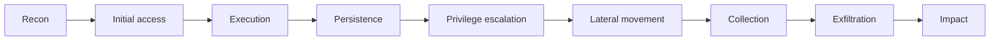

<strong>Authorisation required.</strong> Every technique in this part is written for a lab you own or a target you are contracted to test. Read <a href="/start-here/ethics-and-authorisation/">Ethics and authorisation</a> first. Commands are shown commented out, with their expected effect, on purpose.

## The shape of an intrusion

Offensive work follows a repeatable sequence. ATT&CK names the tactics; the sequence is the
same whether the target is a web app or an Active Directory estate.

The exam skill is not "run the tool". It is knowing **where you are in that chain** and what
the next cheapest step is.

## The pages in this part

| Page | Question it answers |
| --- | --- |
| [Recon and OSINT](/offensive/recon-osint/) | What can I learn without touching the target? |
| [Scanning and enumeration](/offensive/scanning-and-enumeration/) | What is exposed, and what is it running? |
| [Exploitation basics](/offensive/exploitation-basics/) | How does a bug become control? |
| [Web exploitation](/offensive/web-exploitation/) | How do I test an application systematically? |
| [Linux privilege escalation](/offensive/linux-privilege-escalation/) | How do I go from user to root? |
| [Windows privilege escalation](/offensive/windows-privilege-escalation/) | How do I go from user to SYSTEM? |
| [Active Directory](/offensive/active-directory/) | How do I move through a domain? |
| [Password attacks](/offensive/password-attacks/) | What are the real limits of guessing? |
| [Post-exploitation](/offensive/post-exploitation/) | What happens after the first shell? |
| [Cloud attack paths](/offensive/cloud/) | How do I move from a credential to data? |
| [Social engineering](/offensive/social-engineering/) | How do people get tricked, technically? |

## Mindset: least effort, highest evidence

A professional tester behaves differently from someone collecting shells:

- **Prefer the simplest proof.** A read of one record proves an IDOR; dumping the table proves
  the same thing and creates a data-protection incident.
- **Stop at the objective.** If the objective is "reach the finance share", reaching it is the
  end. Domain admin is not a trophy.
- **Record as you go.** Timestamped commands and outputs are the report. Reconstructing later
  produces errors.
- **Respect the scope, including the clock.** Testing after the window ends is unauthorised
  access.
- **Know when to call the client.** Critical findings, evidence of a real intruder, and
  accidental damage are all phone calls, not report entries.

## What offensive knowledge buys a defender

Understanding attacks is not optional for defence:

- Detection rules are hypotheses about attacker behaviour. You cannot write them from a
  vulnerability scanner output.
- Prioritisation depends on exploitability, which is an offensive judgement.
- Incident response needs to know what an attacker would do next.

This is why the [defensive part](/defensive/) is cross-linked throughout.

## Legal and safety rails

- Written scope before the first packet.
- No denial-of-service unless explicitly permitted.
- No data exfiltration beyond the minimum proof; delete test data afterwards.
- No social engineering of people outside the agreed list.
- Report critical findings immediately.

The [law part](/law/) explains what happens when those rails are ignored.
