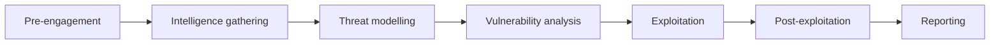

## The standards, compared

| Standard | Version | Best for | Status |
| --- | --- | --- | --- |
| PTES | unversioned (2014-era) | Phase vocabulary, pre-engagement detail | Unmaintained |
| OSSTMM | 3.02 (2010) | Measurement-led assurance | Dormant; v4 not released |
| NIST SP 800-115 | 2008 final | Process, evidence, reporting for government | Not revised |
| OWASP WSTG | 4.2 (2020) | Web test coverage | v5 in development |
| MITRE ATT&CK | v20.0 (2026) | Behaviour mapping for detection | Actively maintained |
| TIBER-EU | current | Threat-intel-led red teaming | Financial sector |

None of them is current in the sense that software is current. Use them for structure, and cite
the version so a reader knows what you meant.

## The seven phases

**1. Pre-engagement.** Scope, contract, rules of engagement, schedule, communication plan.

**2. Intelligence gathering.** Passive first: registries, certificates, code, people. Then active:
DNS, scanning, service enumeration. Output: a target map with hypotheses.

**3. Threat modelling.** Which threats matter for this client? A hospital's threat model differs
from a bank's. Use the client's own risk register plus sector intelligence.

**4. Vulnerability analysis.** Turn hypotheses into confirmed weaknesses. Distinguish
*configuration evidence* from *exploitation evidence*; the report must be honest about which.

**5. Exploitation.** Reach the agreed objective with the least intrusive method. Record
everything, including failures, because failed attempts are detection evidence.

**6. Post-exploitation.** Prove impact, measure detection, clean up. This is where the report
gains its value: not "we got in" but "nobody saw us for 40 minutes".

**7. Reporting.** Ranked, reproducible, actionable. Then retest.

## Coverage, not randomness

Build a test matrix before testing:

| Area | Tests | Status |
| --- | --- | --- |
| Authentication | WSTG ATHN-01..10 | planned |
| Authorisation | WSTG ATHZ-01..04 | planned |
| Session | WSTG SESS-01..09 | planned |
| Input validation | WSTG INPV-01..19 | planned |
| Business logic | WSTG BUSL-01..09 | planned |
| API | OWASP API Top 10 | planned |

The matrix is also the report appendix. It shows what was tested, what was not, and why. A report
without coverage is unfalsifiable.

## Time-boxing

A test is always time-limited, so prioritise:

1. Scope-critical objectives.
2. Internet-facing systems.
3. Authentication and authorisation.
4. Anything the client already suspects.
5. Breadth over depth once the core is covered.

Say explicitly what was not reached. "Not tested due to time" is a finding about assurance, not a
failure of the tester.

## Evidence and notes

- One note file per host, timestamped.
- Save raw requests and responses, not screenshots alone.
- Record the exact command and its output.
- Note the time spent; it justifies the report's depth.
- Hash evidence bundles when disputes are plausible.

## Exercise

Take a lab application and write the test matrix before touching it. Then execute only the
authorisation row. Compare: how many findings did a planned row produce versus an unplanned
exploration?
