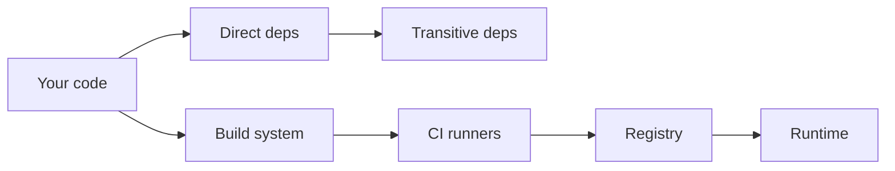

## The trust graph

Your software is a small part of what you run. The rest is dependencies, build tools, base
images, registries, and the people who maintain all of it.



An attacker needs one weak node. Defenders need to know all of them.

## Attack patterns

**Typosquatting** — a package named `reqeusts` that installs a payload on `npm install`.

**Dependency confusion** — publishing a public package with the same name as an internal one, so
the resolver picks the public (attacker) version. Defence: scope internal packages, pin
registries per scope.

**Compromised maintainer** — a legitimate package, a stolen npm token, a malicious version.
Defence: lockfiles, review diffs on update, short-lived publish tokens, provenance.

**Build system compromise** — the SolarWinds pattern: modify the build, keep the source clean.
Defence: isolated builders, reproducible builds, signed provenance, egress restriction.

**Malicious CI workflow** — a pull request from a fork runs with secrets. Defence: no secrets on
`pull_request` from forks, least-privilege tokens, environment protection rules.

## What actually reduces risk

| Control | Effect | Cost |
| --- | --- | --- |
| Lockfile committed | Reproducible dependency set | Low |
| Hash pinning | Registry cannot swap bytes | Low |
| Dependency review on update | Sees new code and new maintainers | Medium |
| Private registry proxy | Blocks unknown packages | Medium |
| SBOM generation | Inventory for incident response | Medium |
| Build provenance (SLSA) | Verifiable build chain | High |
| Reproducible builds | Detects build tampering | High |
| Egress-restricted builders | Stops exfiltration and downloads | Medium |

Start at the top. A team with lockfiles and hash pinning is already ahead of most.

## SBOMs, honestly

A Software Bill of Materials answers "are we affected?" in minutes instead of days. It does not
answer "is this dependency safe". Treat it as an inventory, not a verdict. Formats: CycloneDX
and SPDX.

```bash
# Generate an SBOM for a container image (example tooling)
# syft registry.example/app:1.2.3 -o cyclonedx-json > sbom.json
# grype sbom:sbom.json
```

The value is realised only if you can act: an owner, a patch path, and a way to deploy.

## Incident: what to do in the first hour

1. Identify the affected package and versions (SBOM or lockfiles).
2. Determine exposure: is it in a running service, a build tool, or a dev dependency?
3. Block egress from affected hosts.
4. Revoke credentials that the CI or runtime could reach.
5. Patch or pin to a known-good version, then verify the artefact hash.

The most common mistake is patching the source while the compromised binary stays deployed.

## Detection

- New outbound destinations from CI runners or package hosts.
- `postinstall` scripts spawning shells or network tools.
- A dependency version published minutes ago, pulled automatically.
- Registry token used from an unexpected IP.
- Build artefact hashes changing without a source change.

The last one is the highest-signal control in the list, and the one almost nobody implements.

## Exercise (local only)

1. Take a small project with a lockfile.
2. Generate an SBOM and count transitive dependencies.
3. Pick one dependency and check: maintainer count, last release, open critical issues, whether
   it has provenance.
4. Add hash pinning and a CI step that fails on an unexpected lockfile change.

The number in step 2 usually surprises people. That is the lesson.
